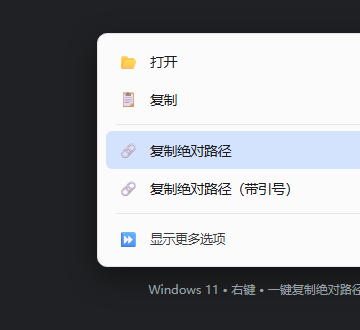

# Windows 11 右键「复制绝对路径」

右键一键复制文件/文件夹的绝对路径到剪贴板，支持带引号版本。纯 PowerShell + 注册表，无需安装任何软件、无需管理员权限、可随时卸载。

> 这个项目正是为了解决「把图片保存到本地后，再手动输入完整路径给 AI 对话框」的痛点而写：右键 → 复制路径 → 粘贴，三步变一步。

🌐 **语言 / Language**：[简体中文](README.md) | [繁體中文](docs/README.zh-Hant.md) | [English](docs/README.en.md) | [日本語](docs/README.ja.md) | [Español](docs/README.es.md)

---

## 效果预览



## 功能

- 右键**文件 / 文件夹 / 驱动器** →「显示更多选项」→「复制绝对路径」，一键复制完整路径
- 可选「复制绝对路径（带引号）」，方便直接粘贴到命令行参数位置
- 纯 PowerShell + 注册表，不装软件、不常驻后台、不联网
- 只写当前用户注册表（`HKCU`），无需管理员权限，可随时卸载
- 已用含**中文、空格、方括号**的路径实测通过

## 使用

### 1. 安装（只跑一次）

下载本仓库，然后在 PowerShell 里执行：

```powershell
powershell -NoProfile -ExecutionPolicy Bypass -File .\Install-CopyPath.ps1
```

### 2. 使用

右键任意文件 / 文件夹 / 驱动器 →「显示更多选项」→「复制绝对路径」。约 1 秒后剪贴板里就是完整路径，直接粘贴到任何对话框。

### 3. 查看状态 / 卸载

```powershell
# 查看安装状态
powershell -NoProfile -ExecutionPolicy Bypass -File .\Install-CopyPath.ps1 -Status

# 卸载
powershell -NoProfile -ExecutionPolicy Bypass -File .\Install-CopyPath.ps1 -Remove
```

## 原理

- `CopyPath.ps1`：接收一个路径，用 `Resolve-Path` 得到绝对路径，写入剪贴板
- `Install-CopyPath.ps1`：在 `HKCU\Software\Classes\*\shell`（以及 `Directory`、`Drive`）下写入右键菜单项，菜单命令为「隐藏调用 powershell.exe → 执行 CopyPath.ps1，把 `%1`（被右键的路径）复制进剪贴板」
- 安装时会把 `CopyPath.ps1` 复制到 `%LOCALAPPDATA%\CodexTools\CopyAbsolutePath\`，右键菜单调用的是这一份

## 常见问题

- **Windows 11 找不到菜单项？** 注册表静态菜单在 Win11 里位于「显示更多选项」（右键菜单最底部）。想放进新式紧凑菜单需要 Nilesoft Shell 等工具。
- **中文乱码？** 脚本以 UTF-8 with BOM 保存；若自行修改请保持该编码。
- **误删了工作脚本？** 右键菜单会失效，重跑安装脚本即可恢复。
- **能用 Windows 10 吗？** 可以，原理相同；Win10 菜单项直接出现在右键菜单里。

## License

[MIT](LICENSE)