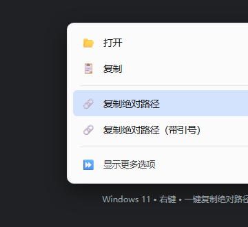

# Windows 11 Right-click "Copy Absolute Path"

One right-click copies the absolute path of a file/folder to your clipboard, with an optional quoted version. Pure PowerShell + Windows registry — no extra software, no admin rights, easy to uninstall.

> Built to solve the pain of "save an image locally, then type the full path into an AI chat box by hand": right-click → copy path → paste.

🌐 **Language**: [简体中文](../README.md) | [繁體中文](README.zh-Hant.md) | [English](README.en.md) | [日本語](README.ja.md) | [Español](README.es.md)

---

## Preview



## Features

- Right-click **file / folder / drive** → "Show more options" → "Copy absolute path"
- Optional "Copy absolute path (with quotes)" for pasting into command-line arguments
- Pure PowerShell + registry: no extra software, no background process, no network
- Only writes the current-user registry (`HKCU`): no admin rights, fully reversible
- Tested with paths containing **Chinese characters, spaces, and brackets**

## Usage

### 1. Install (once)

Clone/download this repo, then run in PowerShell:

```powershell
powershell -NoProfile -ExecutionPolicy Bypass -File .\Install-CopyPath.ps1
```

### 2. Use

Right-click any file / folder / drive → "Show more options" → "Copy absolute path". Wait ~1 second, then paste it anywhere.

### 3. Check status / uninstall

```powershell
powershell -NoProfile -ExecutionPolicy Bypass -File .\Install-CopyPath.ps1 -Status
powershell -NoProfile -ExecutionPolicy Bypass -File .\Install-CopyPath.ps1 -Remove
```

## How it works

- `CopyPath.ps1` — resolves the path and writes it to the clipboard
- `Install-CopyPath.ps1` — writes context-menu entries under `HKCU\Software\Classes\*\shell` (plus `Directory`, `Drive`); the menu item runs hidden `powershell.exe` → `CopyPath.ps1` with `%1` (the path you right-clicked)
- The installer copies `CopyPath.ps1` to `%LOCALAPPDATA%\CodexTools\CopyAbsolutePath\`, which is what the menu actually calls

## FAQ

- **Can't find it on Windows 11?** Static registry menu items live under "Show more options". For the new compact menu, tools like Nilesoft Shell are needed.
- **Garbled Chinese text?** Scripts are saved as UTF-8 with BOM; keep that encoding if you edit them.
- **Deleted the worker script?** The menu item stops working; just re-run the installer.
- **Works on Windows 10?** Yes, same mechanism; the item shows directly in the right-click menu.

## License

[MIT](../LICENSE)